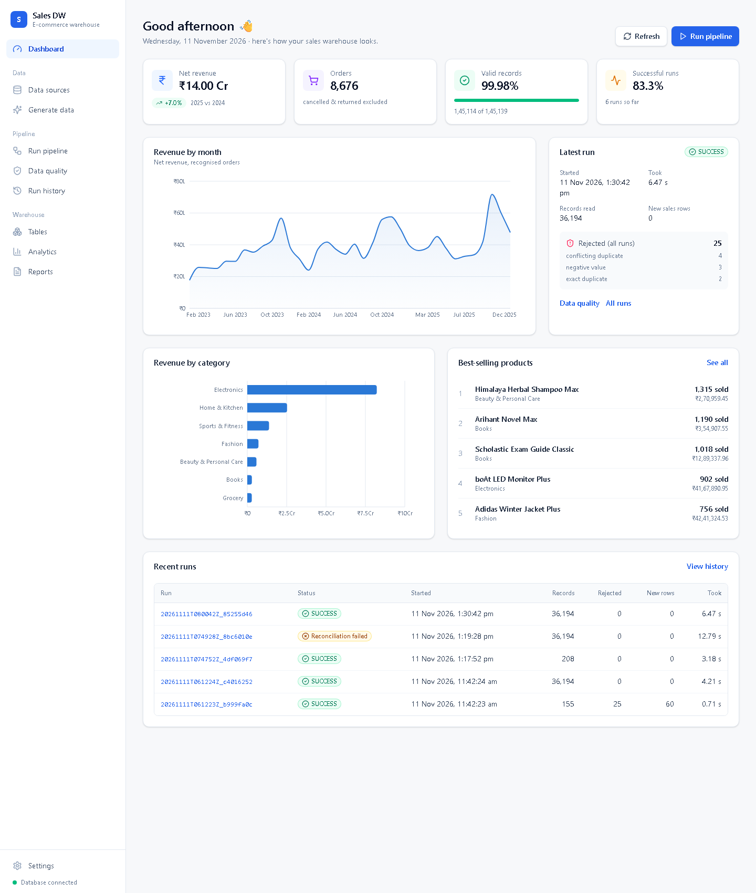

# E-Commerce Sales Data Warehouse

Workshop assignment: an ETL pipeline that loads e-commerce order data into a star schema
in PostgreSQL 18, with a FastAPI backend and a React front end to run it and look at the
results.

Generated CSV data (customers, products, orders, order items) is validated, bad rows are
quarantined, and the rest is loaded into `fact_sales` plus customer, product and date
dimensions. Customer and product dimensions keep history (SCD Type 2). Each run is
logged and reconciled against the source. Re-running the same files does not create
duplicates. There are 120 pytest tests (ETL + API); the largest test load was 100,000
order lines.



---

## Folder structure

```
workshop hackthon/
├── frontend/                 React + TypeScript + Vite + Tailwind + Recharts + Lucide
│   ├── src/api/              central HTTP client (client.ts) and endpoints (endpoints.ts)
│   ├── src/types/api.ts      TypeScript interfaces = API contract
│   ├── src/hooks/            useApi (loading/error/reload), usePolling (pipeline status)
│   ├── src/components/       layout (sidebar, top bar) and reusable UI (cards, tables, charts, states)
│   └── src/pages/            10 pages (Dashboard ... Settings)
├── backend/                  Python 3.12 + FastAPI
│   ├── app/main.py           application, CORS, error handlers
│   ├── app/config/           settings from environment / .env
│   ├── app/database/         connection (engine, init_db, COPY), models (table catalog)
│   ├── app/api/routes/       dashboard, datasets, generator, pipeline, quality, warehouse,
│   │                         analytics, reports, history, system (health/config)
│   ├── app/services/         ingestion, validation, transformation, loading, monitoring,
│   │                         reconciliation, analytics + pipeline, run_tracker, reporting,
│   │                         datasets, generator_service, benchmark, scenarios
│   ├── app/generators/       Faker + NumPy data generator
│   ├── app/schemas/          Pydantic request/response models
│   ├── app/cli.py            command-line interface
│   ├── tests/                pytest suite (+ expected-results fixture)
│   ├── requirements.txt  .env.example  Dockerfile
├── other/
│   ├── sql/                  source_schema, warehouse_schema, indexes, analytical_queries
│   ├── datasets/             sample/ (committed), generated/, invalid/, uploads/
│   ├── reports/              reconciliation, data quality, performance, test and build reports
│   ├── documentation/        architecture, data dictionary, design decisions, test scenarios, setup guide
│   ├── docker/               docker-compose.yml, frontend Dockerfile, nginx.conf, certs/
│   └── screenshots/          the running application
└── README.md
```

## Technologies

| Layer | Stack |
|---|---|
| Frontend | React 19, TypeScript 5.8 (strict), Vite 6, Tailwind CSS 4, Recharts 3, Lucide, React Router 7 |
| Backend | Python 3.12, FastAPI, SQLAlchemy 2, psycopg 3 (COPY), pandas 3 + pyarrow, NumPy, Pydantic 2, Faker |
| Database | PostgreSQL 18 |
| Testing | pytest (+ FastAPI TestClient), TypeScript compiler |
| Delivery | Docker, Docker Compose, nginx |

## Architecture

```
 React dashboard ──HTTP/JSON──> FastAPI ──> services ──> PostgreSQL 18
 (frontend/)                   (backend/app)              raw.*    landed CSV records (per run)
                                  │                       source.* typed source tables (ODS)
                                  │ POST /api/pipeline/run  dw.*     star schema
                                  ▼                       ops.*    runs, metrics, quarantine
 CSV extract ─> validate ─> raw + quarantine (commit) ─> transform
            ─> [ one transaction: source upserts ─> SCD2 dimensions ─> date dim
                 ─> facts with point-in-time keys ─> fact upsert ] ─> reconcile ─> run status
```

**Star schema** - `dw.fact_sales` (grain: **one product line within one customer order**)
joined to `dw.dim_customer` (SCD2 on city/state/country), `dw.dim_product` (SCD2 on
category/brand) and `dw.dim_date` (key `YYYYMMDD`). Measures: `gross_sales = quantity ×
unit_price`, `net_revenue = gross_sales − discount_amount` (exact NUMERIC). Surrogate
keys are resolved by the **order timestamp** against each version's effective range.

Details: [architecture](other/documentation/architecture.md) ·
[data dictionary](other/documentation/data_dictionary.md) ·
[design decisions](other/documentation/design_decisions.md) ·
[test scenarios](other/documentation/test_scenarios.md) ·
[setup guide](other/documentation/setup_guide.md)

## Quick start (Docker)

```powershell
cd "other\docker"
Copy-Item .env.example .env       # set DB_PASSWORD (and ports if 5432/8000/8080 are busy)
docker compose up -d --build
start http://localhost:8080
```

Then **Data Generator -> Generate dataset** and **Pipeline -> Run pipeline**.
Services talk by name: backend -> `postgres:5432`, nginx -> `backend:8000`.

## Manual setup (Windows PowerShell)

**Database** - PostgreSQL 18 with a database `workshop_dw` (native install or
`docker run -d -e POSTGRES_PASSWORD=change_me -e POSTGRES_DB=workshop_dw -p 5432:5432 postgres:18`).

**Backend**

```powershell
cd backend
py -3.12 -m venv .venv
.\.venv\Scripts\Activate.ps1
pip install -r requirements.txt
Copy-Item .env.example .env       # edit DATABASE_URL
python -m app.cli init-db
uvicorn app.main:app --reload --port 8000     # http://localhost:8000/docs
```

**Frontend**

```powershell
cd frontend
npm install
Copy-Item .env.example .env.local # VITE_API_BASE_URL=http://localhost:8000
npm run dev                       # http://localhost:5173
npm run build                     # production build (strict type check)
```

## Dataset generation

```powershell
cd backend
python -m app.generators.generate_data --customers 1000 --products 200 --orders 10000 --seed 42
python -m app.generators.generate_data --customers 10000 --products 1000 --order-items 100000
python -m app.generators.generate_data --invalid           # separate folder + defect manifest
```

Same seed = identical files. Clean data goes to `other/datasets/generated`, invalid test
data to `other/datasets/invalid` (never mixed). The UI's Data Generator does the same.

## Pipeline execution

* UI: **Pipeline** page -> choose the source (generated, uploaded, sample, invalid) -> **Run
  pipeline**. Progress is the backend's real stage, polled every second.
* CLI: `python -m app.cli run --input ..\other\datasets\generated`
* Re-running the same files inserts nothing (facts are upserted on
  `(source_system, order_item_id)` with a content hash); a corrected record updates in place.

## Testing

```powershell
cd backend;  pytest -v            # 120 tests on an isolated <DB_NAME>_test database
cd frontend; npm run build        # TypeScript strict + production build
```

Last results: `other/reports/test_report.txt` (120 passed),
`other/reports/frontend_build_report.txt`.

## Reports

| File | Content |
|---|---|
| `other/reports/reconciliation_report.csv` | source-vs-warehouse checks of the latest run (written by every run) |
| `other/reports/data_quality_report.csv` | valid/rejected, categories, reason codes, entities |
| `other/reports/performance_report.txt` | measured 1K/10K/100K benchmark + COPY vs INSERT experiment |
| `other/reports/test_report.txt` | full `pytest -v` output |

The **Reports** page shows them and exports CSV/JSON via `/api/reports/export`.

Measured on this machine (100,000 order lines, end to end): **26.6 s, 3,756 rows/s**;
re-running the same files inserted 0 rows; COPY was **54.5× faster** than row-by-row INSERT.

## Docker instructions

```powershell
cd "other\docker"
docker compose up -d --build        # build + start postgres, backend, frontend
docker compose ps                   # health status
docker compose logs -f backend
docker compose exec backend pytest -q
docker compose down                 # stop (keeps data volumes); add -v to delete data
```

## Troubleshooting

| Symptom | Fix |
|---|---|
| "API offline" in the top bar | Start the backend; check `VITE_API_BASE_URL` and restart Vite. |
| "...not the Sales Warehouse API" | Another program uses that port - run uvicorn on another port and update `VITE_API_BASE_URL`. |
| `/api/health` -> `connected: false` | PostgreSQL not running / wrong `DATABASE_URL`. |
| HTTP 500 mentioning the schema | `python -m app.cli init-db`. |
| CORS error in the browser console | Add the frontend URL to `CORS_ORIGINS` in `backend/.env`. |
| Docker: port already allocated | Change ports in `other/docker/.env`. |
| Docker build: `CERTIFICATE_VERIFY_FAILED` | Antivirus/proxy TLS interception - see `other/docker/certs/README.md`. |

More in [setup_guide.md](other/documentation/setup_guide.md).
